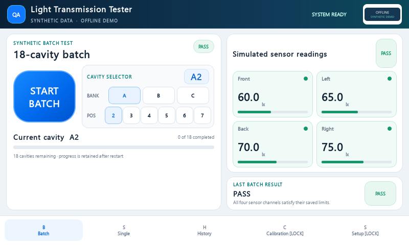
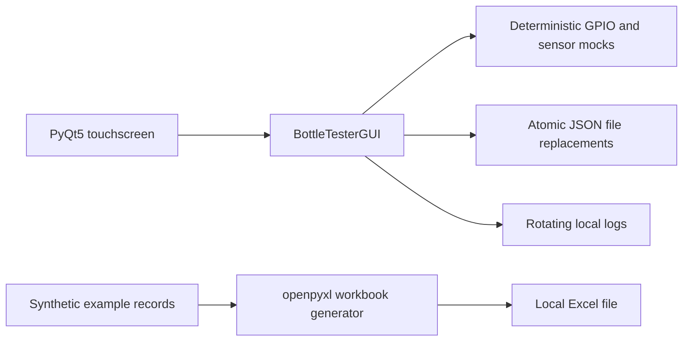

# Light Transmission Quality Tester

A Python/PyQt5 touchscreen application demonstrating four-channel optical quality checks, sample calibration, batch tracking, and local Excel reporting.

**This repository is an offline portfolio edition. All readings and included data are synthetic. It cannot connect to equipment or send email.**



## Problem and scope

Comparing several sensor channels by hand makes it easy to miss an out-of-limit reading or lose track of which samples have been checked. This application presents four light-transmission readings together, applies saved channel limits, and records progress through an 18-position sample batch.

Despite the earlier wall-thickness terminology retained in some internal identifiers, the implementation measures **light intensity in lux**. It does not calculate thickness in millimetres or demonstrate a validated relationship between light transmission and material thickness. PASS and FAIL in this demo are software threshold outcomes, not certification of product quality.

## What it does

- Displays Front, Left, Back, and Right channels in an 800 × 480 touch interface.
- Evaluates PASS when every reading is at or below its configured upper limit; equality passes. The default is 100 lx per channel.
- Blocks a test if the ambient precheck exceeds 500 lx; readings over 500 lx also produce a lid-open result. This is a software heuristic, not a physical interlock.
- Tracks 18 combinations: three banks and six positions. Both PASS and FAIL complete a position; single measurements do not advance the batch.
- Retains the latest 90 history entries, a separate cumulative report history, a lifetime test count, and batch progress in JSON.
- Captures a master reference across three runs, checking repeatability before allowing it to be locked; verifies readings against a locked reference.
- Creates a four-sheet Excel workbook locally: Summary, Detailed Data, Statistics, and Calibration.
- Provides touch input, a demonstration access gate, and an idle screensaver.

## Run the demo

Use a desktop Python installation with pip and Git. Python 3.11 or 3.12 is the CI target; local verification used Python 3.14.2 on Windows. The existing dependency versions are pinned in `requirements.txt`. No Raspberry Pi packages, SMTP account, or equipment are needed.

From the repository directory in **Windows PowerShell**:

```powershell
py -3 -m venv .venv
.\.venv\Scripts\python.exe -m pip install -r requirements.txt
.\.venv\Scripts\python.exe demo.py
```

Using the environment's Python directly avoids changing PowerShell's execution policy. On macOS or Linux, create the environment with `python3 -m venv .venv` and use `.venv/bin/python` for the same commands. A graphical Qt desktop is needed for interactive mode; those platforms have not been verified here.

If the Windows `py` launcher is unavailable, replace `py -3` with the path to an installed Python interpreter. Fresh dependency installation did not succeed in the preparation environment; the successful runtime checks used an existing environment with the pinned versions. See [verification details](docs/VERIFICATION.md) and repeat installation on your intended desktop.

Press **Start Batch** to see a synthetic PASS after the stabilisation delay. Select **Single** for an independent measurement. Open Calibration or Setup with the public demo password **`demo`**. In Calibration, **Test Master Sample** takes three consistent simulated runs; complete the reason/operator fields before locking the reference. Use fictional entries only.

To demonstrate other outcomes, close the application and run:

```powershell
.\.venv\Scripts\python.exe demo.py --scenario fail
.\.venv\Scripts\python.exe demo.py --scenario lid-open
```

To run without a visible window, or generate a workbook:

```powershell
.\.venv\Scripts\python.exe demo.py --headless --scenario pass
.\.venv\Scripts\python.exe demo.py --headless --scenario fail
.\.venv\Scripts\python.exe demo.py --headless --scenario lid-open
.\.venv\Scripts\python.exe demo.py --report
```

Each headless check uses a fresh temporary directory, exercises the test sequence, verifies the result/history/batch state and simulated relay shutdown, then exits with a nonzero status on failure. The report command reads only the four fictional records in `examples/`; its printed workbook path is under `.demo-data/reports/` by default. Open that file in a spreadsheet viewer. Its counts and readings illustrate formatting only.

## Configuration and safe defaults

| Setting | Default | Purpose |
| --- | --- | --- |
| `WTT_DATA_DIR` | `.demo-data/` beside the source | JSON state, rotating logs, and generated reports. Use a new empty directory if overriding. |
| `WTT_DEMO_SCENARIO` | `pass` | Deterministic sensor profile when running `ui.py` directly; `demo.py --scenario` sets it explicitly. |
| `WTT_DEMO_PASSWORD` | `demo` | Optional local demonstration gate. Session changes are not persisted. |

Adjust the four limits through Calibration. `examples/synthetic_calibration.json` documents the reference format and is used by the report demo; it is not automatically imported into GUI state.

The Setup page retains an illustrative configuration form. Delivery is disabled, its credential input is disabled, and no email password is saved. Every delivery method is inert and no email scheduler starts. Do not enter real accounts or contact information. The public demo gate is a UI demonstration, not authentication suitable for deployment.

## Architecture and stack



| File | Responsibility |
| --- | --- |
| `ui.py` | Workflow controller, calibration, evaluation, persistence, keyboard, screensaver |
| `premium_ui.py`, `premium_widgets.py` | Layout construction and reusable native Qt widgets |
| `assets/styles/premium.qss` | Shared interface styling |
| `mock_hardware.py` | In-memory relay/multiplexer and fixed sensor profiles |
| `runtime_paths.py`, `logger_config.py` | Isolated local output paths and rotating logs |
| `excel_export.py` | Workbook generation and parsing history strings |
| `demo.py`, `examples/` | Reproducible offline demonstrations |

The controller uses a Qt timer for the three-second stabilisation delay, then reads channels sequentially. JSON files avoid adding a database dependency; atomic replacement reduces partial-file writes. UI rendering is split from the existing controller to keep presentation separate from workflow logic. Mock devices expose the same small interfaces used by the retained I2C driver reference classes. Those driver classes accept a supplied bus object; the application never creates a real bus or imports a hardware library.

More detail: [architecture and data flow](docs/ARCHITECTURE.md).

## Tests and verification

```powershell
.\.venv\Scripts\python.exe -m unittest discover -s tests -v
.\.venv\Scripts\python.exe -m compileall -q ui.py premium_ui.py premium_widgets.py mock_hardware.py runtime_paths.py logger_config.py excel_export.py demo.py tests tools
.\.venv\Scripts\python.exe tools/check_publication.py
```

The tests cover channel limits, cavity order/progress, persistence, single/batch separation, relay cleanup on errors, protected navigation, layout bounds, offline delivery boundaries, invalid sensor values, and workbook contents. Injected sensor failures intentionally emit error logs during a successful test run.

GitHub Actions repeats compilation, unit tests, all three headless scenarios, report generation, and the publication candidate scan on Windows/Python 3.11 and 3.12. The workflow has been prepared; a hosted Actions run is only possible after upload. See [verification results](docs/VERIFICATION.md) for the actual local checks and their limits.

## Limitations and future work

- No physical sensor, relay, Raspberry Pi, touch panel, enclosure, or production deployment was tested during portfolio preparation.
- The controller remains substantial. Extracting a pure evaluation model and separate persistence service would make further changes easier to test.
- Channel polling still includes short blocking waits on the GUI thread. A worker with signals, cancellation, and an explicit state machine would improve responsiveness.
- Histories use strings rather than a versioned measurement schema. The cumulative report history is not automatically rotated in this offline edition. Schema validation, retention, and migration are sensible next steps.
- JSON replacement is atomic per file, not transactional across files; simultaneous application instances are unsupported.
- Calibration repeatability uses a fixed tolerance of the greater of 2 lx or 2% of the reference. Neither this tolerance nor the lid heuristic is a validated measurement specification.
- Master references are stored separately from the editable PASS/FAIL limits. Locking a reference does not automatically derive new limits.
- Dependencies emit deprecation warnings on the locally installed Python. Updating them should be accompanied by UI and report regression checks.
- Excel history parsing assumes the application's nonnegative lux format. Arbitrary external history imports are outside the supported demo.

## Publication and portfolio notes

See [sanitisation scope and remaining review](docs/PUBLICATION_REVIEW.md), [repository metadata and CV wording](docs/PORTFOLIO.md), and [step-by-step GitHub upload instructions](docs/UPLOAD.md).

No licence or copyright claim has been added. Sanitisation does not establish ownership or permission to publish. Confirm rights to the source, interface, and workflow before making a repository public.
